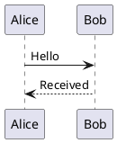

# Using PlantUML Preview

Requires NoteGen 0.38.3 or later.

This development plugin requires the desktop host with the new renderer API. The local development package is available in `.notegen/package`; no installation archive has been published.

1. Enable the plugin and review the matching-code-block disclosure.
2. Open an existing note or insert this fenced block:

````markdown

````

`puml` is also supported. Use a fenced code block, not inline backticks, and include complete diagram markers.

Previews load near the editor viewport. Use **Edit source**, then **Preview** to switch. Keyboard focus inside a code block reveals its source so edits never target hidden text. Errors reveal source without moving focus; use retry to render again. After a timeout, retry starts a fresh isolated engine.

If several plugins handle the same language, choose a default renderer in the block header. The choice is stored per workspace on this device. Disabling or uninstalling the plugin restores ordinary code blocks without changing the note.

Bundled themes are available with `!theme`. File/network `!include`, local files, external standard libraries such as AWS/C4, and remote resources are not supported. Keep diagrams within 32 KiB and 1,000 lines. This version only previews in the editor; Markdown copying and exports retain source, with no promise of PDF/HTML diagram export.

## Suggested manual acceptance (not performed)

- Different and duplicate diagrams, split panes and separate windows.
- Source/preview switching, editing, undo/redo, save/reopen and exact source preservation.
- Light/dark themes, English/Chinese, errors, empty source, long diagrams and narrow windows.
- Disable/reload, workspace changes or Developer Mode revocation during rendering; obsolete output disappears.
- Invalid syntax, unsupported includes, complex diagrams, timeout/retry and typing responsiveness elsewhere in the note.
- No remote requests; ordinary code blocks, Mermaid and existing document previews retain their behavior.
