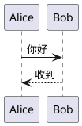

# 使用 PlantUML 预览

最低需要 NoteGen 0.38.3。

这是待验证的开发插件，需要本次新增渲染 API 的桌面宿主。本地开发包已生成在 `.notegen/package`；正式安装包尚未发布。

1. 在插件设置中启用插件，确认其可读取匹配代码块以生成预览的说明。
2. 在笔记中使用以下围栏，或打开已有 PlantUML 笔记：

````markdown

````

也可以使用 `puml` 语言名。不要使用单反引号行内代码。源码应包含完整图表起止标记。

图表进入编辑器可视范围后生成预览。选择“编辑源码”修改内容，再选择“预览”查看图表。编辑器焦点进入代码块时会显示源码，避免编辑隐藏内容。错误会提示原因并显示源码，重试按钮可重新渲染；超时后重试会创建新的隔离渲染实例。

若同一语言有多个插件提供预览，在图表顶部选择默认渲染器。选择按工作区保存在当前设备上。禁用或卸载插件后，围栏恢复普通代码块，笔记内容不变。

内置主题可使用 `!theme`。本版不支持 `!include`、本地文件、AWS/C4 等外部标准库或联网资源。大图请简化到 32 KiB、1,000 行以内。此版本只提供编辑器预览，Markdown 复制和导出仍保留源码，不承诺 PDF/HTML 图表导出。

## 人工验收建议（尚未执行）

- 两个不同图表、重复图表、同笔记分屏和两个窗口分别预览。
- 编辑、撤销/重做、切换源码/预览，再保存重开，确认围栏和源码完整。
- 切换明暗主题与中英文，检查错误、空值、长文本和窄窗口。
- 渲染中禁用插件、切换工作区、重载开发插件或关闭开发者模式，确认旧预览消失。
- 无效语法、不支持的引用、复杂图和超时后重试；同时检查在其他段落输入的流畅度。
- 确认不产生外部请求；普通代码块、Mermaid 和已有文档预览保持原行为。
